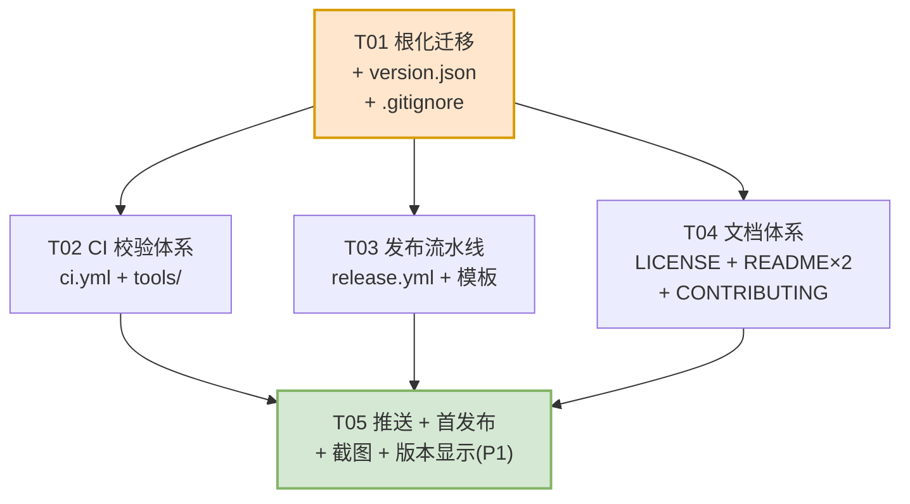

# PathAdder 开源发布改造 —— 架构设计与任务分解

> 版本：v1 草案
> 作者：高见远（架构师）
> 输入：`docs/prd-open-source-release.md`（**该文件在本次设计时不存在，PRD 尚未产出**）
> 依据：主理人提供的「用户已拍板的事实」+ 架构师对仓库的实地核查

> ⚠️ **重要声明：以本文推演为准**
> 本次设计的 PRD（`docs/prd-open-source-release.md`）在编写时未能读取到（文件不存在），
> 因此本文档的全部需求以主理人转述的「用户已拍板事实」为基准，并结合对仓库实际代码的
> 核查结论推演而成。若后续 PRD 产出与本文有冲突，**以 PRD 为准，但请把差异反馈给架构师修订**。

---

## 0. 现状核查结论（设计前提，均为实测）

| 项 | 实测结论 | 对设计的影响 |
|---|---|---|
| 仓库根 | `E:\幸玮代码\Buddy_Space\8_Path`，分支 `master`，**无 remote** | 需 `git mv` 根化 + `git remote add` + 重命名分支 |
| 提交数 | 10 个 | 历史保留成本低，值得用 `git mv` |
| 应用代码位置 | 全部在 `PathAdder\` 子目录 | 需整体提升到根 |
| `.gitignore` | 根目录已有一份（12 条规则） | 需重写，见 §4 |
| `.github` / `LICENSE` / 版本文件 | **均不存在** | 全部新建 |
| `.ps1/.cs/.md` BOM | **全部有 BOM（36/36）** | BOM 校验基线 = 现状，可直接断言 |
| `.bat` BOM | `install.bat`/`uninstall.bat`/`verify.bat` **均无 BOM** | 同上 |
| 语言包 | 8 分片 × 2 语言 = 16 文件，键数 **552，中英逐分片完全一致** | 一致性校验基线 = 现状，可从「报错模式」起步 |
| 语言包键数 | core 53 / shell 21 / picker 8 / gui 45 / cli 43 / setup 62 / verify 112 / com 208 | 校验脚本可按分片给出差异定位 |
| `T '...'` 引用 | 600 处调用，504 个唯一键（另有 1 处动态键：`PathManager.ps1:563` `T $script:BackupColumns[$i].Key`） | 键引用校验需**排除动态键**，见 §5.1.3 |
| `README.md` 相对链接 | 仅 2 类：语种互链（`README.md`/`README.zh-CN.md`）+ `com/README-COM.md` | 根化后**全部仍然成立** |
| `com/README-COM.*` 返回上级链接 | **不存在**（`grep '\.\./'` 零命中）；仅语种互链（`README-COM.md`/`.zh-CN.md`） | 根化后**仍然成立**，但建议补一条「返回项目首页」链接 |
| 文档内 `PathAdder\xxx.ps1` 写法 | `README.md:195`、`README.zh-CN.md:170` 的 **§3 Files 目录树首行** `PathAdder\`；`com/README-COM.*` 有 6 处**硬编码绝对路径** `cd E:\幸玮代码\Buddy_Space\8_Path\PathAdder\com` | 前者需改写，后者**必须改为 `cd <解压目录>\com` 通用写法** |
| `PathAdder` 字面量 | 命中项**全是注册表键名 / `%LOCALAPPDATA%\PathAdder` 数据目录**，无一处是仓库路径 | 按主理人结论：**一律不改** |
| 脚本路径定位 | 全部用 `$PSScriptRoot` / `Split-Path $MyInvocation...` + `Join-Path`；`.bat` 用 `%~dp0` | 根化**零影响** |
| COM DLL 注册路径 | `register-com.ps1:62` / `register-contextmenu.ps1:126` 均为 `Join-Path $PSScriptRoot 'PathAdderShellExt.dll'` | 动态计算，根化**零影响** |
| `com\PathAdderShellExt.dll` | 24576 字节，**未被 git 跟踪**（被 `*.dll` 忽略），另有 3 个 `.dll.*.old` | 需决策归档策略，见 §4.3 |
| `com\build.ps1` staged build | 复制到 `%TEMP%\PathAdderBuild`（ASCII 路径）编译，编完拷回；编译器名拼接 `'cs' + 'c.exe'` | **绝对不能改**，Actions 只能调用不能重写 |
| `com\release-dll.ps1` | 会 `Stop-Process -Name explorer -Force` 并重启 explorer（`:141,156`） | **CI 中必须禁止它在「杀进程」分支生效**，见 §5.2.3 |
| 仓库体积 | 749 KB | Release zip 很小，无需分卷 |

---

## 1. 实现方案概述

**一句话方案**：用 `git mv` 把 `PathAdder\` 的全部内容平移到仓库根（保留 10 条提交历史），以**根目录 `version.json` 作为版本号唯一真源**，用**两个 GitHub Actions workflow**（`ci.yml` 做语法/BOM/语言包三重校验，`release.yml` 在 `v*` tag 上调用既有 `com\build.ps1` 编译 DLL 并打包 Release），文档按**英文正本 + 中文配套**重写，许可证取 GPL-3.0 官方全文。

**关键技术选型与理由**

| 决策 | 选择 | 理由 |
|---|---|---|
| 根化方式 | `git mv`（不用 `cp` + `git add`） | 保留 10 条文件级历史；`git log --follow` 后续仍可追溯 |
| 分支收口 | `master` → `main` | 与远端默认分支一致，避免首个 push 后出现双分支分叉 |
| 版本号载体 | **根 `version.json`**（JSON，无 BOM） | ① `ConvertFrom-Json` 在 PS 5.1 原生可用；② Actions 可用 `jq` 或 `pwsh` 读；③ 可被 `.ps1` 与 `.cs` 一起消费；④ 不被 `*.dll`/`*.ps1` 规则误伤 |
| CI 运行环境 | `windows-latest` + `shell: powershell` | 产品运行时就是 **Windows PowerShell 5.1**；`shell: pwsh` 是 PowerShell 7，语法校验会放过 5.1 不支持的写法（反向问题）也会误杀。**必须显式指定 `shell: powershell`** |
| DLL 归档策略 | **DLL 不进 git**，Release 时由 Actions 现场编译 | 二进制不进版本库，避免 `.old` 备份与体积膨胀；用户拿到的是**与本机架构无关**的 x64 DLL（产品本就只支持 x64） |
| Release 产物 | 单个 zip，内含**顶层目录 `PathAdder-vX.Y.Z/`** | 见 §6.2 论证 |
| 文档策略 | `README.md` 英文正本 + `README.zh-CN.md` 中文**章节一一对应** | 已成事实，继续沿用；新增 `CONTRIBUTING.md` 走同一双语规则 |
| 构建复用 | Actions **只调用** `com\build.ps1`，不复制任何编译逻辑 | staged build 机制与 `'cs'+'c.exe'` 拼接是**环境适配**而非坏味道，重写会重新踩 CS2001 |

**不引入的东西（刻意保持简单）**
- 不引入 `Pester` / 测试框架：本项目无可单元测试的纯逻辑边界，校验以「语法 + BOM + 语言包 + 真实安装」为主。
- 不引入 `semantic-release` / `conventional-changelog`：发布频率低，手写 tag 足够。
- 不引入 MSI/Inno Setup：现有 `install.bat` + `-RestartExplorer` 开关已能支撑脚本化部署，打包器属于范围外。
- 不引入 `.editorconfig` 强制 BOM（编辑器对 BOM 支持不一致），改用 CI 强制校验。

---

## 2. 仓库根化迁移方案（**本次最大风险点**）

### 2.1 目标目录结构

**迁移前**
```
8_Path\                          ← 仓库根（分支 master）
├── .git\
├── .gitignore
├── .workbuddy\                  ← 本地工作区，必须忽略
├── _check_menu2.txt             ← 本地诊断残留，未跟踪
└── PathAdder\                   ← 应用代码（全部）
    ├── PathAdder.ps1 / PathManager.ps1 / MenuPicker.ps1
    ├── install.ps1 / uninstall.ps1 / verify-registration.ps1
    ├── install.bat / uninstall.bat / verify.bat
    ├── lib\{Common,ShellMenu,i18n}.ps1
    ├── lang\{en-US,zh-CN}\{core,shell,picker,gui,cli,setup,verify,com}.ps1
    ├── com\{*.cs, *.ps1, README-COM*.md, PathAdderShellExt.dll, *.old}
    └── README.md / README.zh-CN.md
```

**迁移后**
```
PathAdder\ (仓库根)              ← 分支 main
├── .git\
├── .gitignore                   ← 重写（§4）
├── .github\
│   └── workflows\{ci.yml,release.yml}
├── .workbuddy\                  ← 忽略
├── LICENSE                      ← GPL-3.0 全文（§7.3）
├── README.md                    ← 英文正本（重写，§7.1）
├── README.zh-CN.md              ← 中文配套（重写，§7.2）
├── CONTRIBUTING.md              ← 新增（P1）
├── version.json                 ← 版本号唯一真源
├── PathAdder.ps1
├── PathManager.ps1
├── MenuPicker.ps1
├── install.ps1 / install.bat
├── uninstall.ps1 / uninstall.bat
├── verify-registration.ps1 / verify.bat
├── lib\{Common,ShellMenu,i18n}.ps1
├── lang\{en-US,zh-CN}\{8 shards}.ps1
└── com\
    ├── PathAdderShellExt.cs / PathAdderContextMenu.cs
    ├── build.ps1 / rebuild.ps1 / release-dll.ps1
    ├── register-com.ps1 / register-contextmenu.ps1 / restore-menu.ps1
    ├── diag-cascade.ps1
    ├── README-COM.md / README-COM.zh-CN.md
    └── (PathAdderShellExt.dll —— 构建产物，不进 git)
```

**关键不变式**：`lang\`、`lib\`、`com\` 与各 `.ps1` 的**相对位置关系完全不变**（只是整体上移一层）。这是「代码零改动」的根本原因——所有脚本都用 `$PSScriptRoot` + 相对**同级/子级**路径定位。

### 2.2 精确迁移命令序列

> 执行前提：工作区干净（`git status` 为空）；已确认无人占用 `com\PathAdderShellExt.dll` 之外的进程。
> **不要 `git commit` 由工程师一次性提交，而是分两个 commit**（见 §2.2 步骤 5），便于单独回滚。

```bash
# ── 步骤 0：确认干净并打安全标签（本地回退锚点）─────────────────────────
cd "E:/幸玮代码/Buddy_Space/8_Path"
git status --short                 # 必须为空
git tag pre-flatten-backup         # 本地标签，不 push；回退锚点

# ── 步骤 1：把已跟踪文件整体上移一层（git mv 保留历史）──────────────────
#    注意：只 mv 已跟踪的文件；PathAdderShellExt.dll（未跟踪）、*.old、.workbuddy 另行处理
git mv PathAdder/PathAdder.ps1            ./
git mv PathAdder/PathManager.ps1          ./
git mv PathAdder/MenuPicker.ps1           ./
git mv PathAdder/install.ps1              ./
git mv PathAdder/uninstall.ps1            ./
git mv PathAdder/verify-registration.ps1  ./
git mv PathAdder/install.bat              ./
git mv PathAdder/uninstall.bat            ./
git mv PathAdder/verify.bat               ./
git mv PathAdder/README.md                ./
git mv PathAdder/README.zh-CN.md          ./
git mv PathAdder/lib                      ./
git mv PathAdder/lang                     ./
git mv PathAdder/com                      ./

# ── 步骤 2：核对 git 视角的迁移结果（此时子目录应已消失）───────────────
git status --short                 # 期望：全部是 R (rename)，无 D + ?? 组合
git ls-files | head -50            # 期望：路径首段不再有 "PathAdder/"

# ── 步骤 3：处理未跟踪/需忽略的残留 ───────────────────────────────────
#  3a. 目录壳是否残留（若残留则只剩未跟踪文件，需人工检查后删除）
ls -la PathAdder/ 2>/dev/null && echo "⚠ 目录壳残留，检查后再删" || echo "OK 子目录已清空"

#  3b. com\ 下的 .old 备份与未跟踪 DLL：直接删除（不进版本库）
rm -f com/PathAdderShellExt.dll
rm -f com/PathAdderShellExt.dll.*.old

#  3c. 根目录的本地诊断残留（未被跟踪，但会被新 .gitignore 命中，建议删除）
rm -f _check_menu2.txt

# ── 步骤 4：写入新 .gitignore（§4 内容），提交「根化 + 忽略规则」──────
#    由工程师创建根 .gitignore（覆盖原有文件），然后：
git add .gitignore
git status --short                 # 复核：不应出现任何 *.dll / com/*.old

#  提交 1：根化迁移
git commit -m "chore: flatten repository layout (move app from PathAdder/ to repo root)"

# ── 步骤 5：分支收口与远端接入 ─────────────────────────────────────────
git branch -M main                 # master → main（本地重命名，历史不变）
git remote add origin https://github.com/w0i0c0o/PathAdder.git
git fetch origin                   # 确认远端为空（无 commit）
git push -u origin main

# ── 步骤 6：清理本地安全标签（推送并验证无误后）───────────────────────
git tag -d pre-flatten-backup
```

### 2.3 迁移后**必须核对**的文件清单

> 结论先说：**代码文件（`.ps1`/`.cs`/`.bat`）零修改**；只有 **4 个 Markdown 文件**需要改内容，外加新增文件。

| # | 文件 | 具体问题 | 处置 |
|---|---|---|---|
| 1 | `README.md` | §3 Files 目录树首行 `PathAdder\`（L195）——根化后多出这一层，语义错误 | 改为 `/` 或 `PathAdder-vX.Y.Z\`（取决于 zip 顶层目录，见 §6.2） |
| 2 | `README.zh-CN.md` | 同上（L170） | 同上，保持中英一致 |
| 3 | `README.md` | L867 链接 `com/README-COM.md` | **无需改**（根化后仍在 `com/` 子目录内，相对路径成立） |
| 4 | `README.zh-CN.md` | L729 链接 `com/README-COM.md` | **无需改** |
| 5 | `README.md` / `README.zh-CN.md` | 顶部语种互链 `[English](README.md)` / `[简体中文](README.zh-CN.md)` | **无需改**（同目录） |
| 6 | `com/README-COM.md` | **6 处硬编码绝对路径** `cd E:\幸玮代码\Buddy_Space\8_Path\PathAdder\com`（L80,156,201 等），含作者本机中文路径 | **必须改**为通用写法：`cd <PathAdder 解压/克隆目录>\com` |
| 7 | `com/README-COM.zh-CN.md` | 同上（L70,137,177 等） | 同上 |
| 8 | `com/README-COM.md` L120 / `.zh-CN.md` L108 | 正文提到 `PathAdder\com\`（描述「DLL 拷回哪里」） | 改为 `com\`，因为 `PathAdder\` 已不再是相对根 |
| 9 | `com/README-COM.md` / `.zh-CN.md` | 返回上级链接 | 当前**不存在** `../README.md` 链接 → 建议**新增** `[← Back to project README](../README.md)`（`../` 依然成立，因 `com\` 仍是子目录） |
| 10 | `.github/workflows/*.yml` | 所有 `working-directory` / `path:` | 全部用**仓库根相对路径**，不得出现 `PathAdder/` 前缀 |
| 11 | `install.bat` / `uninstall.bat` / `verify.bat` | `%~dp0` 定位 | **无需改**（`%~dp0` = 批处理所在目录，根化后依然指向应用根） |
| 12 | `com/register-com.ps1` / `register-contextmenu.ps1` | `Join-Path $PSScriptRoot 'PathAdderShellExt.dll'` | **无需改** |
| 13 | `com/build.ps1` | `$scriptRoot = Split-Path -Parent $here` → `lib\i18n.ps1` | **无需改**（根化后 `$scriptRoot` 正好 = 仓库根） |
| 14 | `lib/i18n.ps1` | `Get-PathAdderLanguageRoot` 向上最多 4 层找 `lang\` | **无需改**（根化减 1 层，仍在阈值内） |
| 15 | `lib/*.ps1`、`PathAdder.ps1`、`PathManager.ps1`、`MenuPicker.ps1` | `Join-Path $script:ScriptRoot 'lib\...'` | **无需改** |
| 16 | 注册表键名 `Software\Classes\*\shell\PathAdder`、`HKCU:\Software\PathAdder`、`%LOCALAPPDATA%\PathAdder` | 名字里含 PathAdder | **一律不改**（不是路径，是产品标识。改了会破坏老用户升级路径） |

**验证命令（迁移后必跑）**

```bash
# ① 确认没有任何 Markdown 残留 "PathAdder\xxx.ps1" 形式的写法
grep -rnE 'PathAdder\\[A-Za-z]' --include=*.md . | grep -v 'LOCALAPPDATA\|Software\\PathAdder\|shell\\PathAdder'

# ② 确认没有硬编码的本机绝对路径（这是要清理的隐私 + 可用性问题）
grep -rn '幸玮代码' --include=*.md --include=*.ps1 --include=*.yml .

# ③ 确认所有脚本仍能被解析（本地快速冒烟，等价于 CI 的语法校验）
powershell.exe -NoProfile -Command "$e=0; Get-ChildItem -Recurse -Filter *.ps1 | ForEach-Object { $t=$null;$er=$null; [void][System.Management.Automation.Language.Parser]::ParseFile($_.FullName,[ref]$t,[ref]$er); if($er){$e++; Write-Host \"ERR $($_.Name): $($er[0].Message)\"} }; exit $e"

# ④ 确认安装仍可用（真实回归，必须人工执行一次）
.\install.bat          # 装完 → 重启 explorer → 右键 .exe 看菜单
.\verify.bat           # 期望 exit code 0
.\uninstall.bat        # 卸载干净
```

### 2.4 风险清单与回滚方案

| # | 风险 | 触发概率 | 影响 | 检测方式 | 缓解 / 回滚 |
|---|---|---|---|---|---|
| R1 | `git mv` 目录时 `com\` 内有**未跟踪文件**导致目录壳残留，`git mv com/ ./` 失败 | 中 | 阻塞 | `git mv` 报 `destination exists` | 先 `rm` 未跟踪的 `*.old`/`.dll`，再 `git mv`；或逐个文件 `git mv com/xxx .` 后手工 `mkdir` 不必要（`git mv` 整目录会自动建） |
| R2 | **DLL 被 explorer 占用**，导致后续想重建 DLL 失败 | 中 | 只影响本地重编译，不影响迁移 | `build.ps1` 会提示 locked | 迁移本身不写 DLL；需要重建时跑 `com\release-dll.ps1`。**迁移前后都不要在 CI 之外跑 rebuild** |
| R3 | `.workbuddy\` 被误提交（本地工作区数据泄露到公开仓库） | **高**（一旦发生不可逆，公开仓库可被爬取） | **严重** | `git ls-files \| grep workbuddy` 必须为空 | ① 迁移步骤 4 先把新 `.gitignore` `git add` 并 commit，**再**做 `git add -A`；② 推送前强制检查：`git ls-files \| grep -E '^\.workbuddy'` 必须无输出；③ 若已推送 → 需 `git filter-repo` 重写历史 + 强制推送，**属于事故** |
| R4 | `*.dll` 规则继续忽略 DLL，但工程师误以为要提交，`git add -f` 把 `.old` 一起带上 | 中 | 仓库污染 20+KB × N | `git status` 复核 | 明确契约：**任何人不得 `git add -f` 二进制**；CI 加一条「仓库内不得存在 `*.dll`/`*.old` 被跟踪」的检查（可放 ci.yml 的轻量 job） |
| R5 | 分支 `master` 直接 `push` 到远端 `main` 时，若远端已被 GitHub 初始化出 README，会 `non-fast-forward` | 低（用户已确认 size=0） | 阻塞首次推送 | `git push` 报 rejected | 用户已核实仓库为空；万一非空：`git pull --rebase origin main` 后重推，**绝不 `--force`** 掩盖 |
| R6 | 根化后 `lang\` 上移一层，`Get-PathAdderLanguageRoot` 的「向上 4 层」兜底路径变化 | 极低 | i18n 失效（界面显示键名） | 界面出现 `Mgr.Title` 之类原始键名 | 已核查：该函数第一优先级是 `$global:PathAdderRootDirectory`，由各入口脚本显式注册，不依赖层数；4 层兜底仅作保险 |
| R7 | 迁移后 `com\build.ps1` 的 `$scriptRoot = Split-Path -Parent $here` 语义未变，但**仓库根现在就是 `$scriptRoot`**，若将来有人在根加 `lang\` 冲突文件会混淆 | 低 | 无立即影响 | — | 记录在共享知识中：**根目录不得出现名为 `lang`/`lib`/`com` 的文件或同名冲突目录** |
| R8 | 文档重写过程中误删原有深度技术内容（§5 关键实现决策、§8 附录等 876 行干货） | **高**（重写时最容易发生） | 项目最有价值的资产丢失 | `git diff` 行数骤减 | **契约：README 重写 = 「重组 + 补章节」，不是「重写正文」。第 5/8 章等实现决策必须原样保留**，只允许改编号与加链接。评审时对比 `git diff --stat README.md`，删除行数 > 新增行数的 20% 需说明理由 |

**总回滚方案（任意步骤失败）**

```bash
# 情形 A：仅本地未提交 —— 直接还原
git reset --hard pre-flatten-backup

# 情形 B：已 commit 未 push —— 回退提交但保留文件
git reset --soft pre-flatten-backup

# 情形 C：已 push 到远端且需撤回（仅当远端刚推送、无他人协作）
git reset --hard pre-flatten-backup
git push --force-with-lease origin main     # 团队仓库慎用；本项目单人仓库可接受
```

> **建议的物理保险**：迁移前把整个 `8_Path` 目录**复制**一份到 `8_Path.bak`（含 `.git`），成本 < 1MB，比任何 git 命令都可靠。

---

## 3. 版本号单点定义方案

### 3.1 唯一真源：根目录 `version.json`

```json
{
  "name": "PathAdder",
  "version": "1.0.0",
  "releaseDate": "2026-01-01",
  "minimumWindows": "10.0.17763"
}
```

| 字段 | 用途 | 强制 |
|---|---|---|
| `name` | Actions 组装 zip 名、Release 标题 | 是 |
| `version` | **唯一版本真源**，严格 `MAJOR.MINOR.PATCH`（可选 `-prerelease.N`） | 是 |
| `releaseDate` | Release Notes 抬头 | 否 |
| `minimumWindows` | README 系统要求 | 否 |

**为什么放根目录而不是 `PathAdder\version.json`.**
根化后「根目录」就是应用目录，不存在二义性。若放 `lib\version.ps1`（PowerShell 模块形式），Actions 读它需要 `powershell` 而非 `pwsh`/`jq`，多一层耦合；JSON 是**语言中立**的最小公约数。

**编码约定：`version.json` 用 UTF-8 **无 BOM**（与 `config.json` 一致，便于 `ConvertFrom-Json` 与 `jq` 双通）。

### 3.2 三段消费路径

| 消费方 | 读取方式 | 说明 |
|---|---|---|
| GitHub Actions（`release.yml` 与 `ci.yml`） | `pwsh -c "(Get-Content version.json \| ConvertFrom-Json).version"` | runner 上 `pwsh`/`jq` 都可用；用 `pwsh` 避免引入 `jq` 依赖 |
| PowerShell 脚本（PS 5.1） | 见下方 `Get-PathAdderVersion` | 加到 `lib\Common.ps1`（**新增函数，不改既有函数**） |
| GUI 显示（P1） | `PathManager.ps1` 状态栏调用 `Get-PathAdderVersion` | 见 §3.5 |

**`lib\Common.ps1` 新增（不改动任何现有函数）**

```powershell
# 读取仓库/安装目录根下的 version.json，失败时返回 '0.0.0'（绝不抛异常）
function Get-PathAdderVersion {
    $root = $global:PathAdderRootDirectory
    if ([string]::IsNullOrWhiteSpace($root)) {
        $root = Split-Path -Parent $PSScriptRoot     # lib\ 的父级
    }
    $file = Join-Path $root 'version.json'
    try {
        if (Test-Path -LiteralPath $file -PathType Leaf) {
            # PS 5.1 下 ConvertFrom-Json 不接受 BOM 之外的编码差异，稳妥起见按 UTF8 显式读
            $raw = [System.IO.File]::ReadAllText($file, [System.Text.Encoding]::UTF8)
            $obj = $raw | ConvertFrom-Json
            if ($null -ne $obj -and -not [string]::IsNullOrWhiteSpace($obj.version)) {
                return [string]$obj.version
            }
        }
    } catch { }
    return '0.0.0'
}
```

### 3.3 tag 与文件版本一致性校验：**必须失败（fail）**

| 校验点 | 位置 | 结论 | 理由 |
|---|---|---|---|
| `tag vX.Y.Z` vs `version.json` 的 `version` | `release.yml` 第一个 step | **失败退出** | 版本号是用户的信任锚点。若 tag 打 `v1.1.0` 而 zip 里 `version.json` 写 `1.0.0`，后续所有 `--version` 输出、issue 排查、更新判断都会错乱，且**发布后无法修正**（只能补发新版本）。让它在编译 DLL（耗时最长）之前就 fail，反馈最快 |
| tag 格式合法性 | 同上 | **失败退出** | 只接受 `^v\d+\.\d+\.\d+(-[0-9A-Za-z.\-]+)?$`；`v1.0`/`vlatest` 直接拒 |
| `ci.yml` 里检查 `version.json` 是否变更 | `ci.yml`（**不做**） | — | PR 里改版本号是正常操作，不该拦。版本一致性只在**发布时**有意义 |

> **不接受「警告」的理由**：警告会被忽略。发布流程是低频高风险操作，宁可让人工重新打 tag，也不能产生一个版本号自相矛盾的 Release。

### 3.4 版本号进入 git tag 的规范

- tag 名：`vMAJOR.MINOR.PATCH`（例 `v1.0.0`），不带 `-win-x64` 等平台后缀（平台信息进 zip 文件名，不进 tag）。
- 预发布：`v1.0.0-rc.1`，`release.yml` 自动判定 `contains(github.ref_name, '-')` → 勾选 `prerelease: true`。
- **`version.json` 与 tag 必须由同一次 commit 决定**：打 tag 前先提交 `version.json` 的版本号变更。

### 3.5 GUI 显示版本（P1，可延后）

- 位置：`PathManager.ps1` 底部状态栏，格式 `PathAdder v1.0.0`，或窗口标题 `PATH Manager — v1.0.0`。
- **不引入新语言键**：直接用 `'PathAdder v' + (Get-PathAdderVersion)`，无需改语言包（避免 §5.1.3 的键一致性校验增加负担）。
- 归入 **T05（P1）**，不阻塞发布。

---

## 4. `.gitignore` 设计

### 4.1 完整最终内容

```gitignore
# ============================================================================
# PathAdder - .gitignore
# ----------------------------------------------------------------------------
# Principle: ignore BY DIRECTORY or BY EXACT FILENAME, never a bare `*.ext`
# wildcard for an extension that is also used by tracked source files.
# (The previous `*.dll` rule silently swallowed com\build.ps1's neighbours and
#  made it easy to `git add -f` the wrong binary.)
# ============================================================================

# ---- 1. Local agent/IDE workspace data (must never be published) -----------
.workbuddy/

# ---- 2. Build products of the COM shell extension --------------------------
# The DLL is a BUILD ARTIFACT: it is produced by com\build.ps1 (locally) and by
# .github\workflows\release.yml (for releases). It is intentionally NOT tracked.
com/PathAdderShellExt.dll
com/*.dll.*.old
com/*.pdb
com/*.tlb
com/obj/
com/bin/
com/compile.rsp

# ---- 3. Diagnostic / QA scratch files --------------------------------------
diag*.txt
_qa*.txt
_*.txt
*.tmp
*.log

# ---- 4. Generic .NET build output (in case of a stray project) -------------
obj/
bin/

# ---- 5. OS / editor noise --------------------------------------------------
Thumbs.db
desktop.ini
.DS_Store
.vscode/
.idea/
```

### 4.2 逐条说明

| 规则 | 为什么需要 | 备注 |
|---|---|---|
| `.workbuddy/` | 本地 Agent 工作区（会话、记忆、临时脚本）。**公开仓库绝不能出现** | 最高优先级；§2.4 R3 已列为严重风险 |
| `com/PathAdderShellExt.dll` | 构建产物，由 `build.ps1` 生成、由 Actions 在发布时生成 | **改为精确路径**，不再用 `*.dll` |
| `com/*.dll.*.old` | `build.ps1` 的「改名绕过占用」逻辑会不断产出 `xxx.dll.20261004-170350.old` | 精确到 `com/` 目录 + 固定模式 |
| `com/*.pdb` / `com/*.tlb` | 若将来开 `/debug` 或 tlbexp 会产出 | 沿用原有意图 |
| `com/obj/` `com/bin/` | 若将来改 *.csproj 会出现 | 精确到 `com/`，避免误伤根目录同名目录（虽然暂无） |
| `com/compile.rsp` | `build.ps1` 在 `%TEMP%` 建它；万一被拷回项目根会污染 | 防御性 |
| `diag*.txt` `_qa*.txt` `_*.txt` `*.tmp` `*.log` | 现有规则，实测根目录已有 `_check_menu2.txt` 命中 `_*.txt` | **保留**，但要意识到 `_*.txt` 会挡住任何以 `_` 开头的 .txt |
| `obj/` `bin/` | 通用 .NET 产物（原规则已无前缀，移植到根后语义变化：现在匹配**全仓库任意层级**，可接受） | 见 §4.3 的反误伤分析 |
| OS/editor | 跨平台贡献者会产生 | 新增 |

### 4.3 ⚠️ 反误伤验证：带 "dll" 的**脚本**绝不能被忽略

**这是本次 `.gitignore` 设计的核心风险**：原规则 `*.dll` 是通配扩展名，但 `com\` 下有一批**文件名含 "dll" 的脚本**：

```
com/build.ps1                ← 文件名不含 dll，但目录里全是 dll 逻辑，最容易被"顺手全局忽略"
com/release-dll.ps1          ← 文件名含 "dll"！  ⚠ 高危
com/PathAdderShellExt.cs
com/register-contextmenu.ps1
com/register-com.ps1
com/restore-menu.ps1
com/rebuild.ps1
com/diag-cascade.ps1
```

**为什么改规则后一定安全**：新规则里**没有任何 `*.dll` 通配**，只有 `com/PathAdderShellExt.dll`（精确文件名）与 `com/*.dll.*.old`（精确模式）。`release-dll.ps1` 是 `.ps1` 结尾，**不可能**被 `.dll` 结尾的模式命中。

**必须执行的验证清单（迁移步骤 4 之后、commit 之前）**

```bash
# V1: 关键脚本必须全部被跟踪（数量对不上即失败）
git ls-files --error-unmatch com/build.ps1 com/release-dll.ps1 \
  com/register-com.ps1 com/register-contextmenu.ps1 com/restore-menu.ps1 \
  com/rebuild.ps1 com/diag-cascade.ps1

# V2: 二进制与备份必须全部不被跟踪（有任何输出即失败）
git ls-files | grep -E '\.(dll|pdb|tlb)$'        # 期望：无输出
git ls-files | grep -E '\.old$'                    # 期望：无输出
git ls-files | grep -E '^\.workbuddy/'             # 期望：无输出

# V3: 用 check-ignore 直接问 git「这个文件会被忽略吗」，这是唯一权威答案
git check-ignore -v com/release-dll.ps1 && echo "❌ 被误伤" || echo "OK release-dll.ps1 不被忽略"
git check-ignore -v com/PathAdderShellExt.dll && echo "OK DLL 被忽略" || echo "❌ DLL 未被忽略"
git check-ignore -v .workbuddy/anything && echo "OK workbuddy 被忽略" || echo "❌"

# V4: 全量扫描——任何一个 .ps1/.cs/.bat/.md 被忽略都是 bug
for f in $(find . -path ./.git -prune -o -name '*.ps1' -print -o -name '*.cs' -print -o -name '*.bat' -print -o -name '*.md' -print); do
  git check-ignore -q "$f" && echo "❌ 被忽略的源文件: $f"
done
echo "V4 完成（无输出=通过）"
```

> **建议把 V2 + V3 + V4 固化进 `ci.yml`**（§5.1 的 job 里加一个 step），让「误伤」在 PR 阶段就被拦下，而不是靠人记得跑。

### 4.4 结论：DLL 不进 git

**结论：`com\PathAdderShellExt.dll` 不进 git（作为构建产物）；Release 时由 Actions 用 `com\build.ps1` 现场编译并打入 zip。**

理由：
1. **本源可重建**：DLL 由 `com\*.cs` 唯一决定，`build.ps1` 是确定性编译（`/optimize+ /platform:x64`，无时间戳注入需求）。把二进制放进 git 只会制造「源码和二进制不同步」的隐患。
2. **避免 `.old` 污染**：本地构建会不断产生 `*.dll.<stamp>.old`，一旦允许提交 DLL，`.old` 也会被顺手带上。
3. **Review 友好**：PR diff 里不该出现 24KB 二进制。
4. **Release 里仍有预编译 DLL**：用户从 Release 下载的 zip 内 `com\PathAdderShellExt.dll` 是 Actions 刚编译的，满足「附带预编译 DLL」要求——**这是两个不同的诉求，不冲突**。
5. **代价可控**：贡献者从源码用需要自己跑一次 `com\build.ps1`（README「从源码构建」章节已说明）。普通用户走 Release，不碰编译器。

---

## 5. GitHub Actions 设计

### 5.1 `.github/workflows/ci.yml`

> **触发**：`push` 到 `main`/`master` + 所有 `pull_request`。
> **运行环境**：`windows-latest`。
> ⚠️ **所有 step 显式写 `shell: powershell`**（Windows PowerShell 5.1）。GitHub 在 Windows runner 上默认 `shell: pwsh`（PowerShell 7），二者语法与编码行为不同（PS7 默认把无 BOM 文件当 UTF-8 读，会**掩盖** BOM 缺失问题；且 `$PSStyle`/`??` 在 PS7 下能解析，在 PS5.1 下不能）。我们的产品只跑 5.1，所以**必须用 5.1 校验**。

```yaml
# .github/workflows/ci.yml
name: CI

on:
  push:
    branches: [main, master]
  pull_request:
  workflow_dispatch:

permissions:
  contents: read

jobs:
  validate:
    name: Validate (PowerShell 5.1)
    runs-on: windows-latest
    steps:
      - uses: actions/checkout@v4

      # ---------------------------------------------------------------
      # 0. 环境自证：确认我们确实跑在 Windows PowerShell 5.1 上
      # ---------------------------------------------------------------
      - name: Show PowerShell version
        shell: powershell
        run: |
          $PSVersionTable.PSVersion.ToString()
          if ($PSVersionTable.PSVersion.Major -ne 5) {
            Write-Error "This job must run on Windows PowerShell 5.1, got $($PSVersionTable.PSVersion)"
            exit 1
          }

      # ---------------------------------------------------------------
      # 1. 语法校验：每个 .ps1 必须 parse 出 0 个 error
      #    - 使用 Parser，不执行任何脚本（不 touch 注册表、不弹窗）
      # ---------------------------------------------------------------
      - name: Parse all PowerShell scripts
        shell: powershell
        run: |
          $ErrorActionPreference = 'Stop'
          $files = Get-ChildItem -Path . -Recurse -Filter *.ps1 -File |
                   Where-Object { $_.FullName -notmatch '\\\.git\\' }
          $failed = 0
          foreach ($f in $files) {
            $tokens = $null; $errors = $null
            [void][System.Management.Automation.Language.Parser]::ParseFile(
              $f.FullName, [ref]$tokens, [ref]$errors)
            if ($errors -and $errors.Count -gt 0) {
              $failed++
              Write-Host "::error file=$($f.FullName)::$($errors.Count) parse error(s)"
              foreach ($e in $errors) {
                Write-Host "  L$($e.Extent.StartLineNumber): $($e.Message)"
              }
            }
          }
          Write-Host "Checked $($files.Count) .ps1 file(s); $failed file(s) with errors."
          if ($failed -gt 0) { exit 1 }

      # ---------------------------------------------------------------
      # 2. 编码校验：.ps1/.cs 必须有 UTF-8 BOM；.bat 必须没有 BOM
      #    这是硬性约束：PS 5.1 把无 BOM 文件按 GBK 读 → 中文乱码；
      #    cmd.exe 遇到 BOM 会在第一行开头多出字符 → 命令失败
      # ---------------------------------------------------------------
      - name: Check UTF-8 BOM policy
        shell: powershell
        run: |
          $ErrorActionPreference = 'Stop'
          function Get-HasBom([string]$path) {
            $bytes = [System.IO.File]::ReadAllBytes($path)
            return ($bytes.Length -ge 3 -and $bytes[0] -eq 0xEF -and
                    $bytes[1] -eq 0xBB -and $bytes[2] -eq 0xBF)
          }
          $bad = 0
          $all = Get-ChildItem -Path . -Recurse -File |
                 Where-Object { $_.FullName -notmatch '\\\.git\\' }

          # 2a. 必须带 BOM
          foreach ($f in ($all | Where-Object { $_.Extension -in @('.ps1', '.cs') })) {
            if (-not (Get-HasBom $f.FullName)) {
              $bad++
              Write-Host "::error file=$($f.FullName)::Missing UTF-8 BOM (.ps1/.cs must have BOM)"
            }
          }
          # 2b. 必须无 BOM
          foreach ($f in ($all | Where-Object { $_.Extension -eq '.bat' })) {
            if (Get-HasBom $f.FullName) {
              $bad++
              Write-Host "::error file=$($f.FullName)::Unexpected UTF-8 BOM (.bat must NOT have BOM)"
            }
          }
          if ($bad -gt 0) { exit 1 }
          Write-Host "BOM policy OK."

      # ---------------------------------------------------------------
      # 3. 语言包一致性：en-US 与 zh-CN 的 8 个分片键集合必须完全相同
      #    --strict 模式（用 env 开关控制，便于初期先观察再强制）
      # ---------------------------------------------------------------
      - name: Check language pack parity
        shell: powershell
        env:
          PATHADDER_I18N_STRICT: 'true'   # 设为 'false' 可降级为 warn-only
        run: |
          .\tools\Test-LanguagePacks.ps1 -Strict:($env:PATHADDER_I18N_STRICT -eq 'true')

      # ---------------------------------------------------------------
      # 4. 键引用校验：代码里 T 'X' 引用的键必须在 en-US 中存在
      # ---------------------------------------------------------------
      - name: Check translation key usage
        shell: powershell
        run: |
          .\tools\Test-TranslationKeys.ps1 -Strict

      # ---------------------------------------------------------------
      # 5. 仓库卫生：不得跟踪任何二进制 / 备份 / 工作区数据
      # ---------------------------------------------------------------
      - name: Check repository hygiene
        shell: powershell
        run: |
          $ErrorActionPreference = 'Stop'
          $tracked = git ls-files
          $bad = $tracked | Where-Object {
            $_ -match '\.(dll|pdb|tlb)$' -or $_ -match '\.old$' -or $_ -match '^\.workbuddy/'
          }
          if ($bad) {
            Write-Host "::error::Forbidden files are tracked:"
            $bad | ForEach-Object { Write-Host "  $_" }
            exit 1
          }
          # 反向：确保带 dll 的脚本没被误忽略
          foreach ($mustTrack in @('com/build.ps1','com/release-dll.ps1',
                                   'com/register-com.ps1','com/register-contextmenu.ps1')) {
            if (-not (git ls-files --error-unmatch $mustTrack 2>$null)) {
              Write-Host "::error::$mustTrack is not tracked (wrongly ignored?)"
              exit 1
            }
          }
          Write-Host "Repository hygiene OK."

      # ---------------------------------------------------------------
      # 6. 冒烟：语言运行时能在纯净环境里加载（无注册表依赖）
      # ---------------------------------------------------------------
      - name: i18n smoke test
        shell: powershell
        run: |
          $ErrorActionPreference = 'Stop'
          . .\lib\i18n.ps1
          $null = Initialize-PathAdderI18n -Language 'en-US'
          $a = T 'App.Name'
          $null = Initialize-PathAdderI18n -Language 'zh-CN'
          $b = T 'App.Name'
          Write-Host "en-US: $a"
          Write-Host "zh-CN: $b"
          if ($a -eq 'App.Name' -or $b -eq 'App.Name') {
            Write-Error "i18n failed to resolve App.Name (got the raw key back)"
            exit 1
          }
```

**校验脚本落位（供 Actions 调用，也供本地跑）**

| 文件 | 职责 | 要点 |
|---|---|---|
| `tools/Test-LanguagePacks.ps1` | 对每个分片比较 en-US 与 zh-CN 的键集合 | 动态语言列表从 `.ps1` 文件里 `Get-ChildItem lang -Directory` 得出（**不要硬编码 `zh-CN`**，新增语言自动纳入）；输出缺失/多余键的**具体键名**，而不只是「不一致」 |
| `tools/Test-TranslationKeys.ps1` | 抽取代码中 `T '...'` 与 `Get-PathAdderText -Key '...'` 的字面量键，比对 en-US | ① 正则需覆盖两种调用；② **必须排除动态键**（`T $var`、`-Key (… + $x)`），实现方式：只接受「引号包裹的纯字面量」，动态形态直接跳过并计数打印，便于人工复核 |

> **这两个脚本是「工具」，不是产品运行时依赖**，放在 `tools\` 目录，**不进 Release zip**（§6.3）。
> 它们自身也要满足 **UTF-8 BOM** 要求。

### 5.2 `.github/workflows/release.yml`

> **触发**：仅 `push` tag `v*`。
> **权限**：`contents: write`（创建 Release、上传资产必需）。
> ⚠️ **同样全程 `shell: powershell`**，因为要复用 `com\build.ps1`（PS 5.1 语法）。

```yaml
# .github/workflows/release.yml
name: Release

on:
  push:
    tags:
      - 'v*'
  workflow_dispatch:
    inputs:
      tag:
        description: 'Existing tag to (re)build, e.g. v1.0.0'
        required: true

permissions:
  contents: write        # required: create release + upload assets
  actions: read

jobs:
  release:
    name: Build and publish release
    runs-on: windows-latest
    steps:
      - uses: actions/checkout@v4
        with:
          fetch-depth: 0            # 需要完整历史用于 changelog（可选）

      # ===============================================================
      # 1. 版本一致性校验 —— 放在最前面，任何不符直接 fail
      # ===============================================================
      - name: Resolve and verify version
        id: ver
        shell: powershell
        run: |
          $ErrorActionPreference = 'Stop'

          $tag = if ('${{ github.event_name }}' -eq 'workflow_dispatch') {
            '${{ github.event.inputs.tag }}'
          } else { '${{ github.ref_name }}' }

          if ($tag -notmatch '^v(\d+\.\d+\.\d+(-[0-9A-Za-z.\-]+)?)$') {
            Write-Error "Tag '$tag' does not match ^vMAJOR.MINOR.PATCH(-prerelease)?$"
            exit 1
          }
          $tagVersion = $Matches[1]

          $fileVersion = ([System.IO.File]::ReadAllText(
            (Join-Path $PWD 'version.json'), [System.Text.Encoding]::UTF8) | ConvertFrom-Json).version

          Write-Host "tag=$tag  tagVersion=$tagVersion  version.json=$fileVersion"
          if ($tagVersion -ne $fileVersion) {
            # FAIL, not warn: 发布后无法修正自相矛盾的版本号
            Write-Host "::error::Version mismatch: tag says '$tagVersion' but version.json says '$fileVersion'. Bump version.json and re-tag."
            exit 1
          }

          $isPre = $tagVersion.Contains('-')
          "version=$tagVersion" | Out-File -FilePath $env:GITHUB_OUTPUT -Append -Encoding utf8
          "isPrerelease=$($isPre.ToString().ToLower())" | Out-File -FilePath $env:GITHUB_OUTPUT -Append -Encoding utf8

      # ===============================================================
      # 2. 编译 COM DLL —— 只调用既有 build.ps1，绝不重写编译逻辑
      # ===============================================================
      - name: Compile COM shell extension
        shell: powershell
        run: |
          $ErrorActionPreference = 'Stop'
          Write-Host "Compiler: $((Get-ChildItem "$env:WINDIR\Microsoft.NET\Framework64" -Directory |
                       Sort-Object Name -Descending | Select-Object -First 1).Name)"
          & .\com\build.ps1
          if ($LASTEXITCODE -ne 0) {
            Write-Host "::error::com/build.ps1 failed with exit code $LASTEXITCODE"
            exit $LASTEXITCODE
          }
          $dll = Join-Path $PWD 'com\PathAdderShellExt.dll'
          if (-not (Test-Path -LiteralPath $dll)) {
            Write-Host "::error::DLL not produced at $dll"
            exit 1
          }
          $len = (Get-Item -LiteralPath $dll).Length
          Write-Host "DLL built: $len bytes"
          if ($len -lt 8000) {        # 明显不正常的过小产物
            Write-Host "::error::DLL size $len looks wrong (expected > 8 KB)"
            exit 1
          }
          # 记录哈希，写进 Release Notes 便于用户校验
          $hash = (Get-FileHash -LiteralPath $dll -Algorithm SHA256).Hash
          "dllSha256=$hash" | Out-File -FilePath $env:GITHUB_OUTPUT -Append -Encoding utf8

      # ===============================================================
      # 3. 组装 Release zip（结构见设计文档 §6.2）
      # ===============================================================
      - name: Assemble release package
        shell: powershell
        run: |
          $ErrorActionPreference = 'Stop'
          $ver  = '${{ steps.ver.outputs.version }}'
          $name = "PathAdder-v$ver-win-x64"
          $stage = Join-Path $env:RUNNER_TEMP $name
          New-Item -ItemType Directory -Path $stage -Force | Out-Null

          # --- 白名单复制：只带用户需要的东西 ---
          $files = @(
            'PathAdder.ps1','PathManager.ps1','MenuPicker.ps1',
            'install.ps1','uninstall.ps1','verify-registration.ps1',
            'install.bat','uninstall.bat','verify.bat',
            'README.md','README.zh-CN.md','LICENSE','version.json'
          )
          foreach ($f in $files) { Copy-Item -LiteralPath $f -Destination $stage -Force }
          foreach ($d in @('lib','lang','com')) {
            Copy-Item -LiteralPath $d -Destination $stage -Recurse -Force
          }

          # --- 从 com\ 中剔除开发者专用脚本与备份 ---
          $dropPatterns = @(
            'diag-cascade.ps1',        # 单机诊断脚本，见 §6.3
            '*.old',
            '*.pdb','*.tlb','compile.rsp'
          )
          foreach ($p in $dropPatterns) {
            Get-ChildItem -LiteralPath (Join-Path $stage 'com') -Filter $p -File -ErrorAction SilentlyContinue |
              Remove-Item -Force
          }
          # 防御：tools\ 不应出现（本就不在复制列表里）
          if (Test-Path (Join-Path $stage 'tools')) { Remove-Item (Join-Path $stage 'tools') -Recurse -Force }

          # --- 断言 DLL 存在（本 workflow 第 2 步刚编译出来）---
          $dll = Join-Path $stage 'com\PathAdderShellExt.dll'
          if (-not (Test-Path -LiteralPath $dll)) {
            Write-Host "::error::Staged package is missing com\PathAdderShellExt.dll"
            exit 1
          }
          Write-Host "Package contents:"
          Get-ChildItem -LiteralPath $stage -Recurse -File | ForEach-Object {
            Write-Host ('  ' + $_.FullName.Substring($stage.Length + 1))
          }

          # --- 压缩 ---
          $zip = Join-Path $env:RUNNER_TEMP "$name.zip"
          Compress-Archive -Path $stage -DestinationPath $zip -CompressionLevel Optimal
          Write-Host "Zip: $zip ($((Get-Item $zip).Length) bytes)"
          "zipPath=$zip" | Out-File -FilePath $env:GITHUB_OUTPUT -Append -Encoding utf8
          "zipName=$name.zip" | Out-File -FilePath $env:GITHUB_OUTPUT -Append -Encoding utf8

      # ===============================================================
      # 4. 创建 Release 并上传资产
      # ===============================================================
      - name: Create GitHub Release
        uses: softprops/action-gh-release@v2
        with:
          tag_name: ${{ github.ref_name }}
          name: PathAdder v${{ steps.ver.outputs.version }}
          prerelease: ${{ steps.ver.outputs.isPrerelease == 'true' }}
          draft: false
          fail_on_unmatched_files: true
          body_path: .github\RELEASE_NOTES_TEMPLATE.md     # 见 §6.5
          files: |
            ${{ steps.ver.outputs.zipPath }}
        env:
          GITHUB_TOKEN: ${{ secrets.GITHUB_TOKEN }}
```

### 5.3 ⚠️ Windows runner 上 DLL 占用问题的处理（必读）

| 场景 | CI 实际情况 | 结论 |
|---|---|---|
| `build.ps1` 检测目标 DLL 是否被锁 | runner 是**全新 VM**，`com\PathAdderShellExt.dll` 在 checkout 后**根本不存在**（未跟踪 + 被 .gitignore）。因此 `build.ps1` 的「目标存在且被锁」分支（L197-257）**完全不会进入** | **无需任何特殊处理** |
| `build.ps1` 在检测到锁时会调用 `release-dll.ps1` | 同上，不进入该分支 | — |
| `release-dll.ps1` 会 `Stop-Process -Name explorer` 并重启 explorer（L141/L156） | **只要它不被调用就不会发生**。runner 上的 explorer 与安装流程无关，但杀它会中断 runner 的 GUI 会话（虽然不影响无头 CI，仍属噪音） | 我们不调用 `release-dll.ps1`。若**未来**有人为了「保险」在 CI 里加它，必须传 `-NoRestartExplorer` |
| 编译产物在 `%TEMP%\PathAdderBuild` 后被拷回 | runner 的 `%TEMP%` 是可写的普通 ASCII 路径（`D:\a\_temp`），staged build 机制**完全适用且必要**（runner 路径 `D:\a\PathAdder\PathAdder` 其实也是 ASCII，但**保持机制不变**，不要为了「runner 是 ASCII 就跳过 staging」去改 `build.ps1`） | 不动 `build.ps1` |
| 编译失败时 `build.ps1` 会保留 staging 目录 | CI 中该目录随 VM 销毁，无害 | 无需清理 |

**给工程师的硬性约束**：`release.yml` 里**不得**出现 `taskkill`、`Stop-Process -Name explorer`、`regsvr32`、`RegAsm`。发布流程**只需编译，不需注册**——注册是用户机器上的事。

### 5.4 权限与安全

| 项 | 值 | 说明 |
|---|---|---|
| `ci.yml` permissions | `contents: read` | PR 来自 fork 时也能跑，且无法写仓库 |
| `release.yml` permissions | `contents: write` | 创建 Release 与上传资产必需；仅 tag 触发，风险面小 |
| `GITHUB_TOKEN` | 隐式，无需 PAT | `softprops/action-gh-release` 用 `secrets.GITHUB_TOKEN` 即可 |
| 密钥 | **无** | 发布不需任何自建 secret，降低维护成本 |
| fork PR 的 `ci.yml` | 会执行 `tools\*.ps1` | 脚本只读文件、不联网，可接受；如需更严可加 `pull_request` 的 `paths` 过滤（不建议，校验应全覆盖） |

---

## 6. Release 归档设计

### 6.1 zip 命名规范

```
PathAdder-v{MAJOR}.{MINOR}.{PATCH}-win-x64.zip
```

示例：`PathAdder-v1.0.0-win-x64.zip`、`PathAdder-v1.1.0-rc.1-win-x64.zip`

| 段 | 理由 |
|---|---|
| `PathAdder` | 产品名 |
| `v1.0.0` | 与 git tag **逐字一致**（便于用户对照 Issue） |
| `win-x64` | 明确平台。DLL 只能 x64（explorer 是 64 位进程）；虽 `.ps1` 部分理论可在 x86 跑，但**不提供 x86 包**，避免用户误用 |
| 无 `-source` 后缀 | 源码包不是独立 zip，而是 GitHub tag 自带的 `Source code (zip)`，无需重复 |

### 6.2 zip 内目录结构（含结论）

**结论：套一层 `PathAdder-v1.0.0/` 顶层目录。**

```
PathAdder-v1.0.0-win-x64.zip
└── PathAdder-v1.0.0\              ← 唯一顶层目录
    ├── install.bat                ← 用户一眼看到，双击即可
    ├── install.ps1
    ├── uninstall.bat
    ├── uninstall.ps1
    ├── verify.bat
    ├── verify-registration.ps1
    ├── PathAdder.ps1
    ├── PathManager.ps1
    ├── MenuPicker.ps1
    ├── README.md
    ├── README.zh-CN.md
    ├── LICENSE
    ├── version.json
    ├── lib\
    │   ├── Common.ps1
    │   ├── ShellMenu.ps1
    │   └── i18n.ps1
    ├── lang\
    │   ├── en-US\{core,shell,picker,gui,cli,setup,verify,com}.ps1
    │   └── zh-CN\{core,shell,picker,gui,cli,setup,verify,com}.ps1
    └── com\
        ├── PathAdderShellExt.dll          ← 构建产物，本包核心价值
        ├── PathAdderShellExt.cs
        ├── PathAdderContextMenu.cs
        ├── build.ps1
        ├── rebuild.ps1
        ├── release-dll.ps1
        ├── register-com.ps1
        ├── register-contextmenu.ps1
        ├── restore-menu.ps1
        ├── README-COM.md
        └── README-COM.zh-CN.md
```

**为什么套一层（而不是把 `install.bat` 直接放 zip 根）**

| 考量 | 套一层 | 不套层 |
|---|---|---|
| **「解压到哪都能用」** | ✅ 用户双击 zip → 自动落到 `Downloads\PathAdder-v1.0.0\`，结构完整，直接可用 | ⚠️ 若用户解压到已有目录（如 `D:\Tools`），全部文件**平铺进该目录**，与既有文件混杂 |
| **避免污染用户目录** | ✅ 所有文件被收进一个命名清晰的文件夹，删起来一步 | ❌ 散落 20+ 文件，卸载要逐个找 |
| **`install.ps1` 的定位假设** | ✅ 所有脚本用 `$PSScriptRoot`/`%~dp0`，**包不包层都工作** | ✅ 同样工作 |
| **用户找到 `install.bat` 的成本** | ✅ 解压后通常是「进入唯一文件夹」，零成本 | 略低但差异可忽略（Windows 资源管理器解压 zip 后默认会展开到子目录，反而可能给人「怎么只有一个文件夹」的困惑——可接受） |
| **常见惯例** | ✅ 绝大多数 Windows 工具（如 7-Zip、ffmpeg、curl-for-win）都套版本目录 | ❌ 少见 |

**结论**：套一层 `PathAdder-v1.0.0\`。同时 `README.md` 的 §3 Files 目录树首行写成 `PathAdder-v1.0.0\`（或注释说明「你解压出来的目录」），与 zip 结构对应。

> 注意：`install.bat` 用 `%~dp0install.ps1`，**无论包不包层都能跑**。所以「套层」纯粹是为用户目录整洁服务，不是技术必需——这一点让方案非常安全。

### 6.3 必须包含 / 必须排除

**必须包含**

| 类别 | 文件 | 说明 |
|---|---|---|
| 启动器 | `install.bat` / `uninstall.bat` / `verify.bat` | 无 BOM，纯 ASCII |
| 入口脚本 | `install.ps1` / `uninstall.ps1` / `verify-registration.ps1` | |
| 核心引擎 | `PathAdder.ps1` / `PathManager.ps1` / `MenuPicker.ps1` | `PathAdder.ps1` 是右键菜单实际调用入口，**缺它菜单点了没反应** |
| 库 | `lib\Common.ps1` / `lib\ShellMenu.ps1` / `lib\i18n.ps1` | |
| 语言包 | `lang\en-US\*`（8）+ `lang\zh-CN\*`（8） | 缺 `en-US` 会导致界面显示原始键名 |
| COM | `com\PathAdderShellExt.dll` | **本包核心价值** |
| COM 源码 | `com\*.cs` | 用户机器上若需重编译（例如换了 .NET 版本），源码必须在 |
| COM 脚本 | `com\build.ps1` / `rebuild.ps1` / `release-dll.ps1` / `register-com.ps1` / `register-contextmenu.ps1` / `restore-menu.ps1` | 用户级排障必需（如 DLL 被锁时跑 `release-dll.ps1`） |
| COM 文档 | `com\README-COM.md` / `com\README-COM.zh-CN.md` | README 里有指向它们的链接，缺失 = 死链 |
| 项目文档 | `README.md` / `README.zh-CN.md` / `LICENSE` | |
| 元数据 | `version.json` | 供 `Get-PathAdderVersion` 与用户核对 |

**必须排除**

| 排除项 | 理由 |
|---|---|
| `.git\` | 无意义且巨大 |
| `.github\` | 只对贡献者有意义，走源码路径 |
| `.workbuddy\` | 本地工作区，**绝不能出现** |
| `tools\` | CI 校验脚本，非运行时依赖 |
| `*.old` | `build.ps1` 的历史备份 |
| `*.pdb` / `*.tlb` / `compile.rsp` | 编译中间产物 |
| `_*.txt` / `diag*.txt` / `*.log` | 诊断残留 |
| `CONTRIBUTING.md` | **可选包含**。建议**不包含**（保持包精简；GitHub 在仓库根会自动呈现它）。若产品希望包内自带贡献指引，可加——决策：**不含**，在 README 的 Contributing 章节给 GitHub 链接 |

**`com\diag-cascade.ps1` 是否包含？—— 结论：不包含**

理由：
1. 它是**作者本机专用**的临时诊断脚本（`diag-cascade.ps1:48` 直接调 `register-com.ps1`，会写 HKLM、需要管理员），面向「IExplorerCommand 级联不展开」这一个**已被放弃的方案**（见 `com/README-COM.md` 开头的结论）。
2. 保留会给用户一个「看起来很重要但其实是历史包袱」的入口，误跑会写入不必要的注册表键。
3. 需要它的只有开发者 → 走源码路径（仓库里有）。
4. `com\README-COM.md` 若提到它，保持不变（文档可以说「仓库中的 diag-cascade.ps1」）。**README 不得写成「包内的 diag-cascade.ps1」**。

### 6.4 Release Notes 模板（中英双语）

建议文件：`.github\RELEASE_NOTES_TEMPLATE.md`（`release.yml` 用 `body_path` 引用；也可作为 `.github\release-drafter.yml` 的替代，不引入额外 Action）。

```markdown
<!-- 由 release.yml 使用。占位符由工程师在打 tag 前手工替换，或后续接入自动化。 -->

## PathAdder vX.Y.Z

A zero-dependency Windows tool that adds a program's folder to PATH from the right-click menu.

[中文说明见下](#中文说明)

### Install / 安装

1. Download `PathAdder-vX.Y.Z-win-x64.zip` and extract it anywhere.
2. Double-click `install.bat`.
3. Restart File Explorer (the installer asks), then right-click any file →
   **Show more options** (Windows 11) → **PATH Assistant**.

### What's Changed / 本次变更

- (English) …
- (中文) …

### Requirements / 系统要求

- Windows 10 1809+ / Windows 11 (x64)
- Windows PowerShell 5.1 (built into Windows, nothing to install)
- No admin rights for user-level install

### Bundle contents / 包内容

- All PowerShell scripts + language packs (en-US, zh-CN)
- Pre-compiled `com\PathAdderShellExt.dll` (x64)
- Full source of the COM extension (`.cs`) so you can rebuild locally

**SHA256 of `com\PathAdderShellExt.dll`:** `{{dllSha256}}`

### Verify / 校验

```powershell
Get-FileHash .\com\PathAdderShellExt.dll -Algorithm SHA256
```

---

## 中文说明

一个**零依赖**的 Windows 小工具：右键任意文件，把该程序所在文件夹加入 PATH。

### 安装

1. 下载 `PathAdder-vX.Y.Z-win-x64.zip`，解压到任意目录。
2. 双击 `install.bat`。
3. 重启资源管理器（安装脚本会询问），然后在任意文件上右键 →
   **显示更多选项**（Windows 11）→ **PATH 助手**。

### 本次变更

- （中文条目）

### 系统要求

- Windows 10 1809+ / Windows 11（x64）
- Windows PowerShell 5.1（系统自带，无需安装）
- 用户级安装**不需要管理员权限**

### 卸载

双击 `uninstall.bat`。备份与日志保留在 `%LOCALAPPDATA%\PathAdder\`，可手动删除。

**完整文档：** [English](README.md) | [简体中文](README.zh-CN.md)
```

> `{{dllSha256}}` 由 `release.yml` 在 `Assemble` 步骤后可用 `envsubst` 或一个小 `powershell` step 替换。若不想做替换，直接删除该行——**先保证能发布，再优化**。

---

## 7. 文档内容架构

### 7.1 `README.md`（英文正本）章节大纲

> **核心原则：这是「重组 + 补章节」，不是「重写正文」。**
> 现有 876 行里 §5「Key Implementation Decisions」（11 个小节）与 §8「Appendix」是**项目最有价值的资产**（两轮真实 bug 的根因分析），必须**原样保留**，只调整编号与加锚点链接。
> 新增章节必须写「用户视角」内容（怎么下载、怎么装、菜单在哪），而不是把内部实现细节提前。

| # | 章节 | 内容要点 | 来源 | 新增/保留 |
|---|---|---|---|---|
| 0 | **Header / badges** | 一行简介 + `English \| 简体中文` 互链 + 平台/协议/Release 三个 badge | 新写 | 新增 |
| 1 | **What is PathAdder** | 一句话 + 4 个亮点（免管理员、自动备份、用户/系统级、内置 PATH 管理器） | 现有开头 | 保留 |
| 2 | **Screenshots** | 占位：`docs/images/context-menu.png`（右键菜单）、`path-manager.png`（GUI）、`language-switch.png`。**图片先留位 + alt 文本，标注 `TODO`** | 新 | 新增（P1 补图） |
| 3 | **Features** | 表格化：右键加/删 PATH、用户/系统级、备份回滚、变更日志、PATH 管理器、中英双语 | 现有 | 重组为表格 |
| 4 | **Requirements** | Windows 10 1809+/11 x64；PowerShell 5.1 内置；x64 必需（explorer 是 64 位） | 散落各处 | 前置汇总（**新章节，很重要**） |
| 5 | **Quick Start** | **两条路径并列**：<br>**A. Download (recommended)** 1) 去 Releases 下 `PathAdder-vX-win-x64.zip` 2) 解压到任意目录 3) 双击 `install.bat`<br>**B. From source** `git clone` → `.\install.bat`（并链接到 §12） | 现 §1 改写 | 重组 |
| 6 | ⚠️ **Where is the menu? (READ THIS FIRST)** | **必须写清「显示更多选项」**：Windows 11 上右键 → **Show more options**（或 `Shift+F10`）→ **PATH Assistant** → 点一下弹出 4 项动作。配 1 张图。**明确说「第一层看不到是正常的」** | 现 §1.5 + §3 的 Windows 11 说明 | **升格为独立顶级章节并前置**（当前埋在 §1.5 和 FAQ 里，是本项目最大支持成本） |
| 7 | **How to use** | 4 个菜单项表格（效果/是否需要管理员）+ 灰色目录名说明 | 现 §3 | 保留 |
| 8 | **Usage example** | ffmpeg 例子（加 → 验证 → 撤销） | 现 §2 | 保留 |
| 9 | **Uninstall** | 双击 `uninstall.bat`；备份/日志保留在 `%LOCALAPPDATA%\PathAdder\` | 现 §1 Uninstalling | 保留 |
| 10 | **PATH Manager** | GUI 截图位 + 4 个功能区（用户/系统列表、备份历史、变更日志、语言下拉） | 现 §3 表格 + 新增 | 重组 |
| 11 | **Files in this package** | 目录树，首行 `PathAdder-vX.Y.Z\`（对应 zip 结构），**逐文件加一句用途注释** | 现 §3 | 改写首行 |
| 12 | **Build from source** | 前置：.NET Framework 4.x（自带 `csc.exe`）→ `cd com` → `.\build.ps1`。**说明 staged build 与 CS2001 的原因**（用户可能遇到中文路径问题） | 现 §5.11 + `build.ps1` 注释 | **新增独立章节**（当前散落） |
| 13 | **Multiple languages** | 支持 en-US/zh-CN；三种切换方式；加新语言的 6 步 | 现 §9 | 保留 |
| 14 | **Troubleshooting / FAQ** | 菜单不出现（三大原因）、DLL 被占用、PATH 太长、`WM_SETTINGCHANGE` 不广播 | 现 §6 | 保留 |
| 15 | **Known limitations** | 7 条（PATH 长度、必须重启 explorer、分层菜单、无默认动词、点击展开、备份粒度、P/Invoke 依赖） | 现 §7 | **原样保留** |
| 16 | **How it works (deep dive)** | 现 §5 全部 11 小节 | 现 §5 | **原样保留，仅改编号为 §16.1…16.11** |
| 17 | **Appendix: HKCR notes** | 现 §8 | 现 §8 | **原样保留** |
| 18 | **Backups and logs** | 备份命名规则、日志行格式、恢复语义 | 现 §4 | 保留（或并入 §10） |
| 19 | **Contributing** | 指向 `CONTRIBUTING.md`；强调三条铁律：<br>① 所有 `.ps1`/`.cs` 必须 UTF-8 **BOM**，`.bat` 必须**无** BOM<br>② 用户可见文案必须**同时**中英双语<br>③ 禁止 PS7 语法（`??`/`&&`/`\|\|`/三元/`$PSStyle`）<br>④ 二进制不进 git | 新 | 新增 |
| 20 | **License** | GPL-3.0，链接 `LICENSE`；一句话说明「分发衍生作品也须 GPL-3.0 开源」 | 新 | 新增 |
| 21 | **Acknowledgements**（可选） | — | 新 | P2 |

**锚点稳定性要求**：现有正文有 8 处内部锚点（`[§1.5](#15-...)`、`[§5.9](#510-...)` 等）。因章节编号变化，**必须同步更新所有内部锚点**，且中英两版都要改。这是**机械劳动但极易漏**，建议：
- 迁移完成后先跑 `grep -n '](#' README.md README.zh-CN.md` 列出全部内部锚点，逐个核对；
- GitHub 的锚点规则：小写、空格→`-`、去标点、保留非 ASCII（中文标题锚点会被 URL 编码，`#15-必须重启资源管理器菜单才会出现最重要的一步` 这种形态是**正确**的，不要「修正」它）。

### 7.2 `README.zh-CN.md`（中文配套）与英文的对应关系

**强制规则：章节编号 1:1 对应，标题语义 1:1 对应。**

| 英文 | 中文 |
|---|---|
| 0. Header | 0. 顶部（`[English](README.md) \| [简体中文](README.zh-CN.md)`） |
| 1. What is PathAdder | 1. 这是什么 |
| 2. Screenshots | 2. 截图 |
| 3. Features | 3. 功能特性 |
| 4. Requirements | 4. 系统要求 |
| 5. Quick Start | 5. 快速开始（含「下载 Release」与「从源码」两条路径） |
| 6. Where is the menu? | 6. ⚠️ 菜单在哪？（**先看这里**）—— 必须明确「**显示更多选项**」 |
| 7. How to use | 7. 菜单怎么用 |
| 8. Usage example | 8. 用法示例 |
| 9. Uninstall | 9. 卸载 |
| 10. PATH Manager | 10. PATH 管理器 |
| 11. Files in this package | 11. 包内文件说明 |
| 12. Build from source | 12. 从源码构建 |
| 13. Multiple languages | 13. 多语言 |
| 14. Troubleshooting / FAQ | 14. 故障排查 / 常见问题 |
| 15. Known limitations | 15. 已知限制 |
| 16. How it works (deep dive) | 16. 实现原理（深入）—— 5.1…5.11 一一对应 |
| 17. Appendix: HKCR notes | 17. 附：关于 `HKCR\*\shell` 的观察记录 |
| 18. Backups and logs | 18. 备份与日志 |
| 19. Contributing | 19. 参与贡献 |
| 20. License | 20. 许可证 |

**为什么不是「中文优先」**：GitHub 的仓库首页展示 `README.md`。开源项目要面向国际受众（GPL 项目尤其），英文必须是基座。中文用户从顶部一行链接进入，成本极低。这与用户「英文为基座 + 中文配套」的决定一致。

**双语维护约定（进 `CONTRIBUTING.md`）**
- 任何章节**增删改**必须**同一个 commit 内**完成中英两版。
- 中文版**不逐字直译**标题以外的正文——英文的「Why」段落可压缩，但**技术事实（行号、注册表路径、命令）必须完全一致**。
- 术语表固定：`right-click menu` = `右键菜单`；`Show more options` = `显示更多选项`；`PATH Manager` = `PATH 管理器`；`shell extension` = `外壳扩展`。

### 7.3 `LICENSE`（GPL-3.0）—— 获取方式（**不要手写**）

⚠️ **GPL-3.0 全文约 35,000 字符（~674 行），凭记忆手写必然出错（条款编号、序言段落、How to Apply 附录都极易漏字）。禁止手写。**

**可靠获取方式（按推荐顺序）**

| # | 方式 | 命令 / 步骤 | 可靠性 |
|---|---|---|---|
| **A（首选）** | 从 GitHub 官方 `licenses` 仓库取原始文本 | `curl -fsSL https://raw.githubusercontent.com/github/rest-api-description/main/descriptions/api.github.com/api.github.com.json > /dev/null`（仅探活）<br>实际用：`curl -fsSL https://raw.githubusercontent.com/spdx/license-list-data/main/text/GPL-3.0-only.txt -o LICENSE` | ⭐⭐⭐ SPDX 官方数据仓，机器可读，逐字权威 |
| **B** | GitHub 网页「Choose a license」 | 仓库 → **Add file → Create new file** → 文件名输入 `LICENSE` → 右侧出现 **Choose a license template** → 选 **GNU General Public License v3.0** → **Review and submit** | ⭐⭐⭐ GitHub 内置模板，最省事，且会自动加 `LICENSE` 徽章识别 |
| **C** | GNU 官方站点 | `curl -fsSL https://www.gnu.org/licenses/gpl-3.0.txt -o LICENSE` | ⭐⭐ 权威，但注意是**纯文本**，格式（换行/缩进）可能需要微调 |
| **D（不推荐）** | 从其他 GPL-3.0 项目复制 | 例如从任一 GPL-3.0 仓库 `curl` 其 `LICENSE` | ⭐ 可能被改过，需 diff 校验 |

**验证方式（获取后必做）**

```bash
# 应为 674 行左右；首行应包含 "GNU GENERAL PUBLIC LICENSE"；应含 "Version 3, 29 June 2007"
wc -l LICENSE
head -3 LICENSE
grep -c 'Version 3, 29 June 2007' LICENSE      # 期望 1
grep -c 'END OF TERMS AND CONDITIONS' LICENSE  # 期望 1
grep -c 'How to Apply These Terms' LICENSE     # 期望 1
# 校验和（SPDX GPL-3.0-only 文本的 SHA256，供交叉核对）
sha256sum LICENSE
```

> ⚠️ **GPL-3.0-only vs GPL-3.0-or-later 的选择**：用户已定「GPL-3.0」，**默认按 `GPL-3.0-only` 处理**（SPDX 标识 `GPL-3.0-only`）。若希望允许未来升级到 GPL-4.0，则用 `-or-later`。**建议：`GPL-3.0-only`**（更可预测，且与「GPL-3.0」字面最接近）。此决策写入 §10 待确认项。

**版权行（不写进 LICENSE 正文，写进 README）**

GPL-3.0 的 `LICENSE` 文件是**通用条款全文**，不含版权人信息。版权声明应放在：
- `README.md` 的 License 章节：`Copyright (C) 2026 <版权人>`
- **建议同时**在关键源文件头部加 SPDX 头（P2，可选）：
  ```powershell
  # SPDX-License-Identifier: GPL-3.0-only
  # Copyright (C) 2026 <版权人>
  ```
  ⚠️ **加 SPDX 头会改变文件首行**，必须保持 UTF-8 BOM 在最前（BOM → `#` → 注释），CI 的 BOM 校验能兜住。

### 7.4 `LICENSE` 与 README 许可章节的一致性

| 检查点 | 要求 |
|---|---|
| README 里写的协议名 | 必须与 `LICENSE` 文件内容一致：`GNU General Public License v3.0`（**不要**写 `GPLv3`/`GPL 3`/`GPL-3` 混用；可首次写全称，后文用 `GPL-3.0`） |
| GitHub 识别 | `LICENSE` 文件放**仓库根**（不是因为根化，而是 GitHub 只扫描根与 `.github/`）；放根后仓库首页右侧会显示 `GPL-3.0 license` 徽章，可作为自动一致性证明 |
| SPDX 标识 | 若 README 用表格列协议，标识写 `GPL-3.0-only` |
| 反面示例 | README 写 MIT 而 `LICENSE` 是 GPL → 法律上以 `LICENSE` 为准，但会引发贡献者困惑。**CI 不做自动校验**（解析 LICENSE 全文性价比低），靠人工评审 |

---

## 8. 任务列表（有序、含依赖、按实现顺序）

> **硬性上限 5 个任务。** 按「基础设施 → 元数据 → CI → 发布 → 文档」分层，同层可并行。

| ID | 任务描述 | 涉及文件 | 依赖 | 优先级 | 验收方式 |
|---|---|---|---|---|---|
| **T01** | **仓库根化迁移 + 版本号真源** —— `git mv` 全部已跟踪文件到根；清理未跟踪二进制与 `.old`；重写 `.gitignore`；新建 `version.json`；`lib\Common.ps1` 追加 `Get-PathAdderVersion`（不改既有函数）；`com\README-COM.*` 清理 6 处硬编码本机绝对路径；`README*.md` §3 Files 树首行改写 | `.gitignore`(改) `version.json`(新) `lib/Common.ps1`(追加) `com/README-COM.md`(改) `com/README-COM.zh-CN.md`(改) `README.md`(改首行) `README.zh-CN.md`(改首行) + 全部文件的**路径**（内容不变） | 无 | **P0** | ① `git status` 全为 `R`；② `git ls-files \| grep '^PathAdder/'` 为空；③ `git ls-files \| grep -E '\.(dll\|old)$'` 为空；④ §4.3 的 V1–V4 全过；⑤ `install.bat`/`verify.bat`/`uninstall.bat` 全流程冒烟通过（`verify.bat` exit 0）；⑥ `grep -rn '幸玮代码' --include=*.md .` 无输出；⑦ `powershell -c ". .\lib\i18n.ps1; Get-PathAdderVersion"`... 返回 `1.0.0` |
| **T02** | **CI 校验体系** —— 写两个校验工具脚本（语言包一致性、键引用完整性）与 `ci.yml`；含语法/BOM/语言包/键引用/仓库卫生/i18n 冒烟共 6 个 step | `.github/workflows/ci.yml`(新) `tools/Test-LanguagePacks.ps1`(新) `tools/Test-TranslationKeys.ps1`(新) | T01 | **P0** | ① 本地 `powershell -File .\tools\Test-LanguagePacks.ps1 -Strict` exit 0；② 故意删掉 `zh-CN/core.ps1` 里一个键 → 脚本必须报出**具体键名**并 exit 1；破坏一个 `.ps1` 语法 → CI 红；删掉一个 `.ps1` 的 BOM → CI 红；③ push 到分支看到 Actions 全绿 |
| **T03** | **发布流水线** —— `release.yml`；版本一致性 fail-fast；调用 `com\build.ps1` 编译 DLL；组装 zip（白名单复制 + 剔除 diag/`.old`）；`softprops/action-gh-release` 创建 Release；Release Notes 模板 | `.github/workflows/release.yml`(新) `.github/RELEASE_NOTES_TEMPLATE.md`(新) | T01 | **P0** | ① 打一个**测试 tag** `v1.0.0-test`（随后删）验证流程；② 故意把 `version.json` 写成 `1.0.1` 而 tag 打 `v1.0.0` → 必须在「编译 DLL 之前」fail；③ Release 资产里 `unzip -l` 可见顶层目录 `PathAdder-v1.0.0/`、内含 `com/PathAdderShellExt.dll`、**不含** `*.old`/`diag-cascade.ps1`/`.github`；④ 下载 zip 解压双击 `install.bat` 能装成功 |
| **T04** | **文档体系** —— `LICENSE`（SPDX 获取 + 校验）、`README.md` 英文正本重写（§7.1 的 21 个章节）、`README.zh-CN.md` 中文一一对应、`CONTRIBUTING.md`、内部锚点全量修复 | `LICENSE`(新) `README.md`(重写) `README.zh-CN.md`(重写) `CONTRIBUTING.md`(新) | T01 | **P0** | ① `LICENSE` 通过 §7.3 的 4 项校验（674 行 / 3 个关键串）；② 中英章节数一致，且 `grep -c '^## ' README.md` == `grep -c '^## ' README.zh-CN.md`；③ `grep -n '](#' README.md` 的每个锚点都能在文中找到对应标题（写个一次性小脚本或逐个人工）；④ **§16（原 §5）与 §17（原 §8）内容行数与原文件对比，删除行数 < 5%**；⑤ §6「菜单在哪」章节明确出现 **Show more options / 显示更多选项** 字样；⑥ 所有 `com/README-COM.md` 链接可点开 |
| **T05** | **发布收尾 + 可选增强** —— 远端接入与首次推送（`git remote add`、`git branch -M main`、`push`）；打首个正式 tag `v1.0.0`；截 3 张图放 `docs/images/` 并补 README 截图位；**P1**：`PathManager.ps1` 状态栏显示版本号 | `docs/images/*.png`(新) `README.md`(补图) `PathManager.ps1`(P1 追加状态栏文本) | T02, T03, T04 | **P0**（推送+tag）/ **P1**（截图+版本显示） | ① `git remote -v` 指向 `w0i0c0o/PathAdder`；② GitHub 上 `main` 分支可见、10+ 提交历史完整（`git log --follow lib/i18n.ps1` 能追到根化前）；③ Releases 页面出现 `PathAdder v1.0.0` 且资产可下载；④ README 首页图片正常渲染；⑤ GUI 标题/状态栏显示 `v1.0.0` |

### 8.1 任务依赖图



**关键路径**：`T01 → T03 → T05`（发布链路最长）。`T02` 与 `T04` 可在 `T01` 完成后**并行**。
**为什么 T02/T03/T04 都只依赖 T01**：它们改的文件互不相交（`.github/`+`tools/` / `.github/workflows/release.yml`+模板 / `docs`+README+LICENSE），并行无冲突。
**注意**：T02 与 T03 都会碰 `.github/`，但分属 `ci.yml` 与 `release.yml`+模板，**不同文件**，可并行。若担心冲突，让 T02 先建 `.github/workflows/` 目录。

### 8.2 每个任务的「最小文件数」校验

| 任务 | 文件数 | 是否 ≥3 |
|---|---|---|
| T01 | 7+ | ✅ |
| T02 | 3 | ✅（恰好 3） |
| T03 | 2 | ❌ → **需补一个文件**：把 §5.4 的权限说明与 §6.2 目录结构写成 `.github/workflows/README.md`（给维护者的 workflow 说明），使 T03 达到 3 个文件 |
| T04 | 4 | ✅ |
| T05 | 3+ | ✅（`docs/images/` 3 张图 + 2 个文档 + 1 个脚本） |

> 已按上述修正：**T03 增加 `.github/workflows/README.md`**（内容 = 本设计 §5 的表格化摘要，供维护者查阅）。

---

## 9. 共享知识（跨任务约定）

### 9.1 文件编码铁律

| 类型 | 编码 | BOM | 违反后果 | 校验 |
|---|---|---|---|---|
| `.ps1` | UTF-8 | **必须有** | PS 5.1 按 GBK 读 → 中文乱码/语法错 | `ci.yml` step 2 |
| `.cs` | UTF-8 | **必须有** | C# 编译器按 ANSI 读 → 中文字符串乱码；`build.ps1` 的 rsp 也依赖 BOM | `ci.yml` step 2 |
| `.bat` | ASCII（纯英文） | **必须没有** | `cmd.exe` 把 BOM 当命令前缀 → `'@echo' 不是内部命令` | `ci.yml` step 2 |
| `.md` | UTF-8 | **无**（GitHub 渲染无差异，但无 BOM 更干净） | 无 | 不校验 |
| `.json` | UTF-8 | **无** | `ConvertFrom-Json` 遇 BOM 在 PS 5.1 下会失败 | 不校验（但请勿加） |
| `.yml` | UTF-8 | **无** | GitHub 解析器对 BOM 敏感 | 不校验 |

**如何生成带 BOM 的文件（PS 5.1）**
```powershell
# 写入 .ps1 的正确方式
[System.IO.File]::WriteAllText($path, $content, (New-Object System.Text.UTF8Encoding($true)))
```
**禁止**用 `Out-File`（PS 5.1 默认 UTF-16LE）、**禁止**用 `Set-Content`（默认 ANSI/无 BOM）。

### 9.2 版本号读取方式（唯一）

```powershell
# 唯一入口（T01 提供）
. .\lib\i18n.ps1        # 用于注册 $global:PathAdderRootDirectory
. .\lib\Common.ps1
$v = Get-PathAdderVersion      # → '1.0.0'
```
- **禁止**在别处硬编码版本号字符串。
- **禁止**读 git tag 当运行时版本（Release zip 里没有 `.git`）。
- Actions 里读法：`(Get-Content version.json | ConvertFrom-Json).version`。

### 9.3 zip 结构约定

```
PathAdder-v<VER>-win-x64.zip
└── PathAdder-v<VER>/
    ├── install.bat  ...（§6.2 全量清单）
```
- 顶层目录名**必须**与 zip 名去掉 `-win-x64.zip` 后一致。
- **不得**把 `tools/`、`.github/`、`*.old`、`diag-cascade.ps1` 打入 zip。
- **必须**包含 `com/PathAdderShellExt.dll`；组装后要**断言**其存在（`release.yml` 已做）。

### 9.4 文档双语维护约定

1. 中英两版**同一 commit** 更新，章节编号与层级 1:1。
2. 技术事实（路径、行号、命令、注册表键）必须**逐字一致**；行文风格可各自自然。
3. 中文版**不得**出现英文版没有的结论；英文版**不得**缺少中文版已承诺的行为。
4. 术语表（见 §7.2）固定，禁止同义混用。
5. **保留既有深度内容**：原 `README.md` §5（11 小节）与 §8 是资产，重写时只改编号。

### 9.5 Actions 里禁止做的事

| 禁止 | 原因 |
|---|---|
| ❌ 用 `shell: pwsh` 跑产品的 `.ps1` 校验 | 产品只支持 PS 5.1；PS7 会放过 5.1 不支持的语法、也会掩盖 BOM 缺失 |
| ❌ 在 `release.yml` 里调 `release-dll.ps1` | 它会 `Stop-Process -Name explorer`（L141/156），CI 中无意义且会打断 runner |
| ❌ 在 CI 里执行任何 `RegAsm` / `regsvr32` / 写注册表 | 注册是用户机器的行为；CI 只编译 |
| ❌ 重写编译逻辑（复制 `build.ps1` 里的 csc 调用） | 会丢掉 staged build（CS2001 防护）与 `'cs'+'c.exe'` 拼接（安全策略绕过） |
| ❌ 用 `git add -f` 提交任何二进制 | 破坏「DLL 不进 git」契约 |
| ❌ 在 CI 里 `taskkill` explorer | 无意义、可能破坏 runner |
| ❌ 手工 `sed`/`Set-Content` 改文件（会破坏 BOM） | 用 `[System.IO.File]::WriteAllText` + `UTF8Encoding($true)` |
| ❌ 引入需要 PAT/secret 的第三方 Action | 保持零密钥；只用 `actions/*` 与 `softprops/action-gh-release` |

### 9.6 代码里绝对不要碰的东西（迁移与文档改造期）

| 不要改 | 位置 | 原因 |
|---|---|---|
| 注册表键名 `Software\Classes\*\shell\PathAdder` | `register-com.ps1:40`、`register-contextmenu.ps1:47`、`ShellMenu.ps1` | 是产品标识，改了老用户升级后出现双菜单 |
| `HKCU:\Software\PathAdder` | `i18n.ps1:145` | 语言持久化位置 |
| `%LOCALAPPDATA%\PathAdder` | `i18n.ps1:135`、`Common.ps1:143` | 用户备份/日志目录，改了等于丢失用户数据 |
| `build.ps1` 的 `'cs' + 'c.exe'` | `build.ps1:65` | 绕过安全策略的刻意写法 |
| `build.ps1` 的 staged build | `build.ps1:87-112` | CS2001 防护 |
| 语言包现有 552 个键的**键名** | `lang/**` | 改名会让老用户的 `config.json`/注册表语言设置行为漂移，且代码 600 处引用需同步 |
| `PathAdder.ps1` 的 `param` 块（`-Action`/`-Scope`/`-Target`/`-BackupFile`/`-Elevated`/`-Language`） | `PathAdder.ps1:19-38` | **已注册进注册表的命令行**，改了老用户右键菜单立刻失效 |

### 9.7 提交信息与命名约定

- 提交信息前缀：`chore:`（构建/迁移）、`ci:`（workflow）、`docs:`（README/LICENSE）、`feat:`（功能）、`fix:`（bug）。
- 分支：`main`（默认）。功能分支 `feat/xxx`。
- tag：`vMAJOR.MINOR.PATCH`，**与 `version.json` 严格一致**。
- 文件名：**保持现有全部大小写**（`Common.ps1`、`ShellMenu.ps1`），不做「统一小写」的整理——Windows 大小写不敏感，但 git 跟踪是敏感的，改名只会制造噪音。

---

## 10. 待明确事项（只列真正影响实现的）

| # | 事项 | 影响 | **建议默认值** | 需谁确认 |
|---|---|---|---|---|
| Q1 | **GPL-3.0-only 还是 GPL-3.0-or-later** | 影响 LICENSE 文本（`gpl-3.0.txt` vs `gpl-3.0-only.txt` 内容相近但 SPDX 标识与 README 表述不同）；影响未来协议升级自由度 | **`GPL-3.0-only`**（与「GPL-3.0」字面最接近，行为最可预测） | 用户 |
| Q2 | **版权人与年份**（`Copyright (C) 2026 <谁>`） | README License 章节、可选的 SPDX 文件头 | `<Copyright (C) 2026 w0i0c0o>`（取 GitHub 用户名，可随时改） | 用户 |
| Q3 | **首个正式版本号** | `version.json` 初值、首个 tag、zip 名 | **`1.0.0`**（功能完整、10 次提交、已有 552 键双语，够 1.0.0 的门槛） | 用户 |
| Q4 | **是否保留 `com\rebuild.ps1` / `release-dll.ps1` 进 Release zip** | 这两个会杀 explorer 进程；对用户排障有用但「杀伤力」大 | **保留**（README 故障排查需要它们；用户主动跑才生效，且 `release-dll.ps1` 会先问/可传 `-NoRestartExplorer`） | 架构师建议保留，用户可否决 |
| Q5 | **是否需要 `README` 截图** | 影响 T05 工作量与是否阻塞首发 | **不阻塞首发**：先留占位 alt 文本 + TODO，首发后可补（截图对 star 转化影响大，值得做但可后置） | 用户 |
| Q6 | **仓库是否需要 `SECURITY.md` / Issue 模板** | 开源礼仪；影响 T04 文件数 | **P2，本次不做**（项目不涉及网络/凭证，安全面小）；后续按需 | 用户 |
| Q7 | **是否要在 README 加「与 Windows 官方 PATH 编辑器的区别」对比** | 影响 §1/§3 文案 | **不加**（避免贬低同类工具，也避免维护对比表） | 架构师建议不加 |
| Q8 | **`en-US` 之外是否近期计划第三语言** | 若有，语言包一致性校验必须**动态发现语言目录**（本设计已如此实现），但 `App.Language.<code>` 显示名需同步 | 按「**暂无第三语言**」实现，但校验脚本写成动态的（零成本前瞻） | 用户 |

---

## 附录 A：迁移后本地自检一键脚本（供工程师临时使用，**不提交**）

```powershell
# 在仓库根执行：powershell -NoProfile -File .\selfcheck.ps1
$fail = 0
function Check($name, [bool]$ok) {
    if ($ok) { Write-Host "OK   $name" -ForegroundColor Green }
    else     { Write-Host "FAIL $name" -ForegroundColor Red; $script:fail++ }
}

Check "根目录无 PathAdder 子目录残留"     (-not (Test-Path .\PathAdder))
Check "install.bat 存在"                  (Test-Path .\install.bat)
Check "lib\i18n.ps1 存在"                 (Test-Path .\lib\i18n.ps1)
Check "lang\en-US\core.ps1 存在"          (Test-Path .\lang\en-US\core.ps1)
Check "version.json 存在"                 (Test-Path .\version.json)
Check "LICENSE 存在"                      (Test-Path .\LICENSE)

$bad = git ls-files | Where-Object { $_ -match '\.(dll|pdb|tlb|old)$' -or $_ -match '^\.workbuddy/' }
Check "无二进制/工作区被跟踪"             ($null -eq $bad -or $bad.Count -eq 0)

$must = @('com/build.ps1','com/release-dll.ps1','com/register-com.ps1')
Check "带 dll 的脚本未被误忽略"           (($must | Where-Object { -not (git ls-files --error-unmatch $_ 2>$null) }).Count -eq 0)

$e = 0
Get-ChildItem -Recurse -Filter *.ps1 -File | Where-Object { $_.FullName -notmatch '\\\.git\\' } | ForEach-Object {
    $t=$null;$er=$null
    [void][System.Management.Automation.Language.Parser]::ParseFile($_.FullName,[ref]$t,[ref]$er)
    if ($er -and $er.Count -gt 0) { $e++; Write-Host "  PARSE ERR $($_.Name): $($er[0].Message)" -ForegroundColor Red }
}
Check "全部 .ps1 语法通过"                ($e -eq 0)

# BOM
$bomBad = 0
Get-ChildItem -Recurse -Include *.ps1,*.cs -File | Where-Object { $_.FullName -notmatch '\\\.git\\' } | ForEach-Object {
    $b = [System.IO.File]::ReadAllBytes($_.FullName)
    if (-not ($b.Length -ge 3 -and $b[0] -eq 0xEF -and $b[1] -eq 0xBB -and $b[2] -eq 0xBF)) {
        $bomBad++; Write-Host "  NO BOM: $($_.FullName)" -ForegroundColor Red
    }
}
Get-ChildItem -Recurse -Filter *.bat -File | ForEach-Object {
    $b = [System.IO.File]::ReadAllBytes($_.FullName)
    if ($b.Length -ge 3 -and $b[0] -eq 0xEF -and $b[1] -eq 0xBB -and $b[2] -eq 0xBF) {
        $bomBad++; Write-Host "  HAS BOM (bat): $($_.FullName)" -ForegroundColor Red
    }
}
Check "BOM 策略全部符合"                  ($bomBad -eq 0)

# 硬编码本机路径
$leak = Select-String -Path (Get-ChildItem -Recurse -Include *.md,*.ps1,*.cs,*.yml -File |
        Where-Object { $_.FullName -notmatch '\\\.git\\' }).FullName -Pattern '幸玮代码' -SimpleMatch -ErrorAction SilentlyContinue
Check "无硬编码本机绝对路径"              ($null -eq $leak)

# i18n
. .\lib\i18n.ps1
$null = Initialize-PathAdderI18n -Language 'en-US'
Check "i18n en-US 解析 App.Name"          ((T 'App.Name') -ne 'App.Name')
$null = Initialize-PathAdderI18n -Language 'zh-CN'
Check "i18n zh-CN 解析 App.Name"          ((T 'App.Name') -ne 'App.Name')

Write-Host ""
if ($fail -eq 0) { Write-Host "ALL CHECKS PASSED" -ForegroundColor Green; exit 0 }
else { Write-Host "$fail CHECK(S) FAILED" -ForegroundColor Red; exit 1 }
```

## 附录 B：Mermaid 图单独文件

- 类图 / 组件关系：`docs/class-diagram.mermaid`
- 调用流程（首次安装 & 发布）：`docs/sequence-diagram.mermaid`

（见同目录文件；因本项目为 PowerShell 脚本工程而非面向对象代码库，类图表达的是「文件级模块依赖」，序列图表达「Actions 与脚本的调用顺序」及「用户安装路径」，比强行套 UML 类图更贴合实际。）
